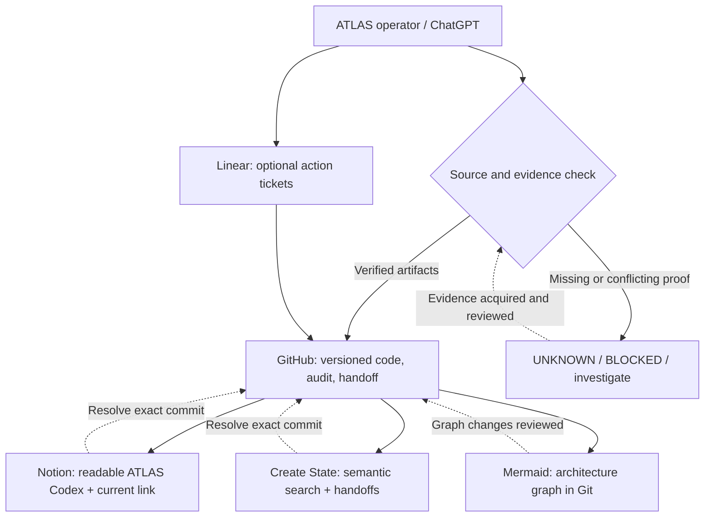

# ATLAS — Continuity & Plugin Architecture (review-only)

**Date:** 2026-10-18 · **Status:** proposed operating contract and connector audit; not deployed automation.  
**Priority:** save durable, source-verifiable state without creating a second ATLAS brain.

## Source-of-truth rule

ATLAS core doctrine: **knowledge over greed, truth over ego, evidence over confidence, process over outcomes**.

**GitHub is the versioned authority for source code, research contracts, test receipts and approved documentation in this review workflow.** A review-branch document is *not* proof of live Supabase/canonical operational state, authentic data-provider receipts, or a placed bet. The live operational ledger, deployment and authorization layers need their own authenticated evidence and should never be reconstructed from a summary.

Other apps are subordinate indexes or presentation surfaces, not authoritative equivalents.



## Connector observations (2026-10-18)

| Product | Observed availability | ATLAS job and boundary |
| --- | --- | --- |
| GitHub | Connected; verified write and read of Arc III checkpoint; latest reviewed commit accessible | Versioned source, evidence, release gates, canonical *documentation*; preserve branch/commit and CI run |
| Notion | Connected; existing `📖 ATLAS CODEX`, existing historical master saves, and reconciliation pages visible | Human-readable index. Link verified GitHub checkpoint rather than copying huge drafts with conflicting versions |
| Create State | Connected; populated `ATLAS Codex` world model and a duplicate empty model; populated model summary last synthesized 2026-10-09 | Search/context and explicit handoffs; **never infer current GitHub reality from graph node counts** |
| Linear | Connected; one `Atlas0.0` team with setup-template issues but no ATLAS projects found | Optional actionable issues/acceptance criteria; do not represent issues as evidence of code/test completion |
| Airtable | Connected; currently no bases visible | Hold. Creating a new base now duplicates repo/Notion. Use only for a deliberately specified structured operational view |
| Google Drive | Connected; an `ATLAS` filename search returned no matches | Optional exported backup location; not an independent verified source by default |
| Mermaid Chart | Diagram connector exposed, but read call returned a connection failure | Keep graphs as Mermaid source in GitHub/Notion, with portable links; standalone diagram app is optional |
| Figma | Available for collaborative visual planning / FigJam | Optional editing canvas; no default promotion to canonical documentation |
| GitBook | Tool surface exposed; no organization/site inventory verified | Optional published manual if existing Notion Codex becomes insufficient |
| Floot | Deliberately parked | Do not restart Floot as a persistence solution |

## Checkpoint routine — proposed, operator-triggered only

1. **Classify:** Is this a code change, research hypothesis, externally corroborated observation, test result, architecture decision, or active operational state? Mark `VERIFIED`, `PARTIAL`, `UNVERIFIED`, `BLOCKED`, or `UNKNOWN`. Explicitly identify synthetic/shadow data.
2. **Preserve evidence:** Commit to a review branch only with evidence/source provenance where available; include specific commit SHA, files changed, CI run + exact status, test environment, blockers and known unknowns. Never claim green before the workflow finishes.
3. **Use one handoff document:** update the relevant Arc III continuation pointer, not duplicate an entire new "mastersave." Append a compact delta and next action.
4. **Index rather than fork:** Capture a short versioned pointer/context in the **existing populated** Create State world model. Put a link to the handoff in the **existing** Notion Codex. Both are navigational copies and may be stale; they must cite the GitHub reviewed commit.
5. **Short-term restore:** create an explicit Create State session handoff only at requested breaks or major checkpoints. The first observed handoff (October 18) reported a **30-day expiry**. Thus it is a convenience, **not permanent archival proof**. Never commit handoff credentials/IDs or private account state to a public repository.
6. **Graph only substantive decisions:** store Mermaid graph text alongside the GitHub audit when nodes, inputs, outputs, consumers, authority boundaries or failure modes actually change. Visual styling alone is not a new module.
7. **Verification / restore order:** GitHub exact handoff commit → current review HEAD & CI → recorded source audits → Notion human index → Create State context/handoff (recoverable, may expire) → actual authenticated operational ledger (only when access is proven). A conflict means flag UNKNOWN, not "latest note wins."
8. **Human Final Gate:** all third-party services are prohibited from placing bets, altering approvals, silently deploying code, handling raw credentials or pretending reviewed synthetic modeling has live pricing authority.

## Active Arc III pause point

The prior GitHub Arc III handoff is:
[Arc III Reality Forge — 15-pass resume handoff](ARCIII_REALITY_FORGE_RESUME_HANDOFF_2026-10-18.md).
At that checkpoint **15 passes planned; 0 formal Arc III sign-offs**. GitHub engineering Pass 0–11/R-01 and Arc II are separate progress ledgers. Floot stays parked.

Latest verified review run as of this note: [39162833183](https://github.com/tyrollclimaco09-oss/Atlas/actions/runs/39162833183) (original baseline custody PASS; offline research 261/261 PASS; Command Center 157/157 PASS; real Chromium 5/5 PASS). Those tests are not evidence of real predictive edge, live market quotes, or production readiness.

**Resume phrase:** `Resume ATLAS Arc III — Pass 1/15: Master Reconciliation from October 18 handoff; keep Floot parked.`

## Minimal data-model for optional future tracking

Every index/checkpoint object should store only these plain metadata fields (no private secrets):

```json
{
  "project": "ATLAS",
  "artifact_type": "review_handoff",
  "authority": "GITHUB_REVIEW_DOC",
  "git_ref": "review/pass0-slate-regression-2026-10-16",
  "commit": "<actual verified commit SHA>",
  "source_path": "docs/ARCIII_REALITY_FORGE_RESUME_HANDOFF_2026-10-18.md",
  "evidence_status": "REVIEW_ONLY",
  "ci_run": "<actual verified run URL>",
  "unresolved": ["release gates", "prospective player evidence", "independent forecast"],
  "next_action": "Arc III Pass 1/15 only on user request"
}
```

One schema, one exact source reference, readable projection. Do not add a new Airtable, Notion database or Supabase table until the above minimal record has proven its value.
