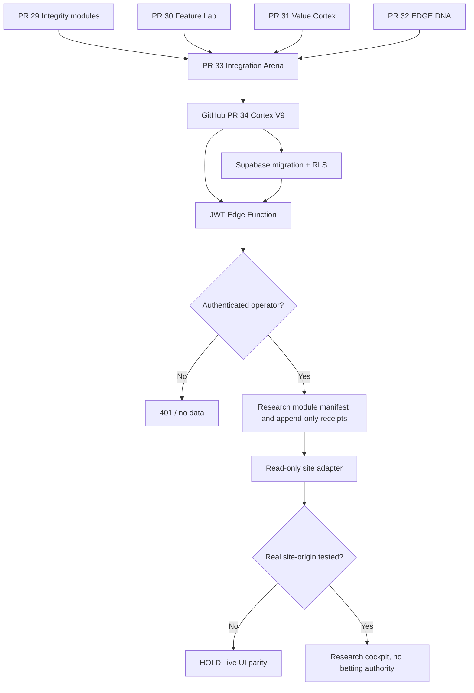

# ATLAS 🦾 — Cortex V9 integration map

**November 5, 2026, CT.** Research-only cross-node integration. No real betting or model-promotion authority.

## Architecture

## Existing infrastructure reused
- One existing Supabase project; its feature registry, SHADOW experiment registry and integration-test records remain authoritative.
- All seven V9 registered research modules have production_authority=false.
- Existing atlas-site-runtime is **unchanged**; V9 is a separate JWT-verified, GET-only Edge Function.
- Supabase applied migration 20261106033701, committed verbatim in the repository. Two additional tables were created with RLS: feature bindings and append-only release receipts.
- Direct table SELECT denied to anon/authenticated, allowed to service_role. No site keys or personal sportsbook data are committed in the public repository.

## Verified vs blocked proof stages

| Stage | State |
|---|---|
| GitHub original research PRs source readback | VERIFIED |
| Applied Supabase migration with matching GitHub SQL | VERIFIED |
| Seven SHADOW feature records and private RLS permissions | VERIFIED |
| Edge Function deployed with verify_jwt=true | VERIFIED |
| Deployed Edge byte-for-byte source parity | Verify with current readback |
| Fresh CI on exact PR head | Await fresh run |
| Authorized HTTP response under real site session | UNVERIFIED |
| Editable original site wiring and publish parity | UNVERIFIED |
| Verified executable DK odds and official roster ingestion | UNVERIFIED |
| Independent predictive advantage on future NBA/NFL slates | UNVERIFIED |
| Human Final Gate | REQUIRED at all times |

## Reader contract
- Function route: atlas-cortex-read-v9. GET only.
- Modes: manifest, receipts, health.
- Auth: existing app_metadata atlas_operator user session, or existing hashed site-reader credential; gateway JWT/publishable-key requirement remains enabled.
- Outputs always carry execution_authority=false, production_authority=false and human_final_gate_required=true.
- Health reports DB_REACHABLE_RESEARCH_ONLY; never converts operational reachability into proven betting readiness.
- Source code: supabase/functions/atlas-cortex-read-v9/index.ts.
- Frontend adapter: src/cortex-read-client.mjs, receives operator credentials only from the already-authenticated site, never hardcodes or stores secrets.

## Follow-through
1. Run fresh GitHub Actions and compare exact GitHub/deployed Edge source.
2. Make a signed-in request from the real published site's actual origin, recording status without capturing secrets.
3. Wire the adapter to the site's Cortex tab only after source parity and operator session are demonstrated. Verify UI state and refresh behavior.
4. Start prospectively frozen NBA/NFL model and price receipts; grade on unseen slates. No fabricated EV.
5. Keep production model changes and actual wagers behind explicit human authorization.
